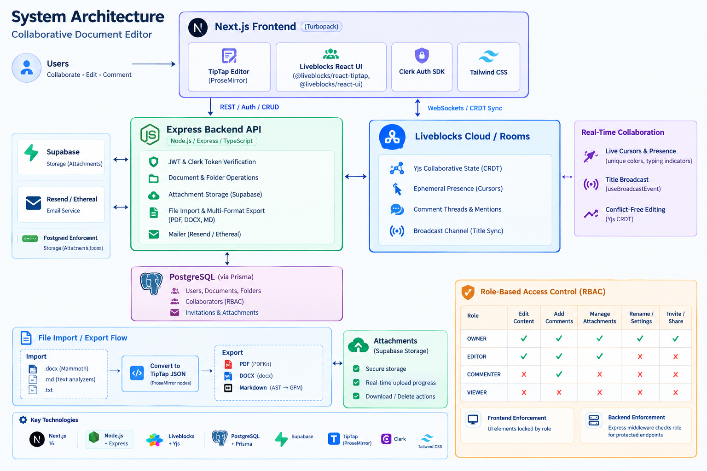

# System Architecture

This document describes the architectural foundation, data modeling, real-time collaboration pipeline, and security mechanisms of the collaborative document editor.



```
+-------------------------------------------------------------------------+
|                              Next.js Frontend                           |
|  - TipTap Editor (ProseMirror)                                         |
|  - Liveblocks React UI (@liveblocks/react-tiptap, @liveblocks/react-ui) |
|  - Clerk Auth SDK                                                       |
|  - Tailwind CSS                                                         |
+--------------------+--------------------------------+-------------------+
                     |                                |
         REST / Auth / CRUD               WebSockets / CRDT Sync
                     |                                |
                     v                                v
+--------------------+--------------+   +-------------+---------------------+
|         Express Backend API       |   |      Liveblocks Cloud / Rooms     |
|  - JWT & Clerk Token Verification |   |  - Yjs Collaborative State (CRDT) |
|  - Document & Folder Operations   |   |  - Ephemeral Presence (Cursors)   |
|  - Attachment Storage (Supabase)  |   |  - Comment Threads & Mentions     |
|  - File Import & Multi-Format     |   |  - Broadcast Channel (Title Sync) |
|    Export (PDF, DOCX, MD)         |   +-----------------------------------+
|  - Mailer (Resend / Ethereal)     |
+--------------------+--------------+
                     |
                     v
+--------------------+--------------+
|     PostgreSQL (via Prisma)       |
|  - Users, Documents, Folders      |
|  - Collaborators (RBAC)           |
|  - Invitations & Attachments      |
+-----------------------------------+
```

---

## 1. High-Level Architecture

The system uses a decoupled client-server architecture paired with an authoritative real-time collaboration sync engine:

1. **Client Layer (Next.js 16 / Turbopack)**:
   - Houses the TipTap rich-text editor engine.
   - Manages local document state, selection toolbars, floating comment composers, anchored threads, and presence avatars.
   - Interacts with the backend via REST endpoints rewritten to `http://localhost:8000`.

2. **API & Business Logic Layer (Node.js / Express / TypeScript)**:
   - Handles persistent document CRUD, folder trees, collaborator assignments, and permission verification.
   - Provides an authorized token endpoint for Liveblocks (`POST /api/liveblocks-auth`).
   - Handles file parsing (`.docx`, `.md`, `.txt`) using Mammoth and text analyzers.
   - Compiles documents into downloadable `.pdf` (PDFKit) and `.docx` (docx) formats.
   - Manages file storage in Supabase Storage buckets.

3. **Multiplayer Collaboration Engine (Liveblocks & Yjs)**:
   - Synchronizes document modifications in real time using Yjs CRDTs, guaranteeing conflict-free concurrent editing without race conditions.
   - Coordinates ephemeral multiplayer state (cursor locations, pointer badges, typing activity) via Liveblocks Presence.
   - Dispatches room broadcast events for zero-latency document title updates across connected peers.

4. **Persistence Layer (PostgreSQL & Prisma ORM)**:
   - Stores documents, revisions, folder hierarchies, collaboration roles, invitations, and attachment metadata.

---

## 2. Real-Time Collaboration Pipeline

### Collaborative Document Editing
- TipTap ProseMirror documents are synchronized with the `@liveblocks/react-tiptap` integration.
- Every keystroke is emitted as a lightweight CRDT update through WebSockets. Even when multiple users edit adjacent paragraphs simultaneously, changes merge deterministically.

### Ephemeral Presence & Live Cursors
- Live cursor tracking is computed relative to the document container rather than raw viewport coordinates.
- Each collaborator is assigned a unique color palette derived from their user ID.
- The `LiveCursors` component displays collaborator name tags and typing indicators without modifying document storage.

### Title Broadcast Synchronization
- The document title is synchronized in real time via Liveblocks broadcast events (`useBroadcastEvent` / `useEventListener`).
- Edits to the document title input immediately propagate to peers and persist to PostgreSQL on blur.

---

## 3. Role-Based Access Control (RBAC)

The system enforces four distinct permission tiers:

| Role | Edit Content | Add Comments | Manage Attachments | Rename / Settings | Invite / Share |
| :--- | :---: | :---: | :---: | :---: | :---: |
| **OWNER** | ✅ | ✅ | ✅ | ✅ | ✅ |
| **EDITOR** | ✅ | ✅ | ✅ | ❌ | ❌ |
| **COMMENTER** | ❌ | ✅ | ❌ | ❌ | ❌ |
| **VIEWER** | ❌ | ❌ | ❌ | ❌ | ❌ |

- **Frontend Enforcement**: Toolbars, inputs, and action buttons dynamically lock based on the collaborator's role.
- **Backend Enforcement**: Express middleware inspects the user's role in the database before granting write permissions on `PATCH /api/documents/:id` and related endpoints.

---

## 4. File Import, Export & Attachments

1. **File Import**:
   - Accepts `.docx` (extracted using Mammoth), `.md`, and `.txt` files.
   - Converts headings, lists, bold text, and formatting into TipTap ProseMirror JSON nodes.

2. **File Export**:
   - **PDF**: Streams a vector PDF rendered with PDFKit, including page margins, metadata headers, and styled paragraphs.
   - **DOCX**: Formats a Microsoft Word document using `docx` with paragraph runs, headings, and bullet points.
   - **Markdown**: Traverses the document AST to generate standard GitHub Flavored Markdown.

3. **Attachments Drawer**:
   - Uses Supabase Storage to store attachments securely.
   - The drawer UI tracks real-time progress percentages during file uploads and provides download/delete actions.
